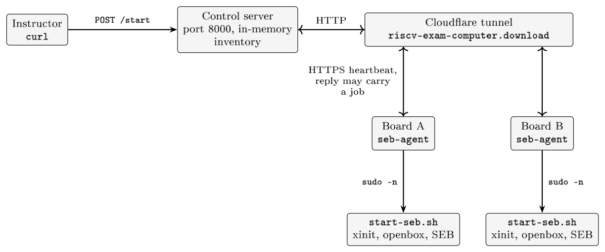
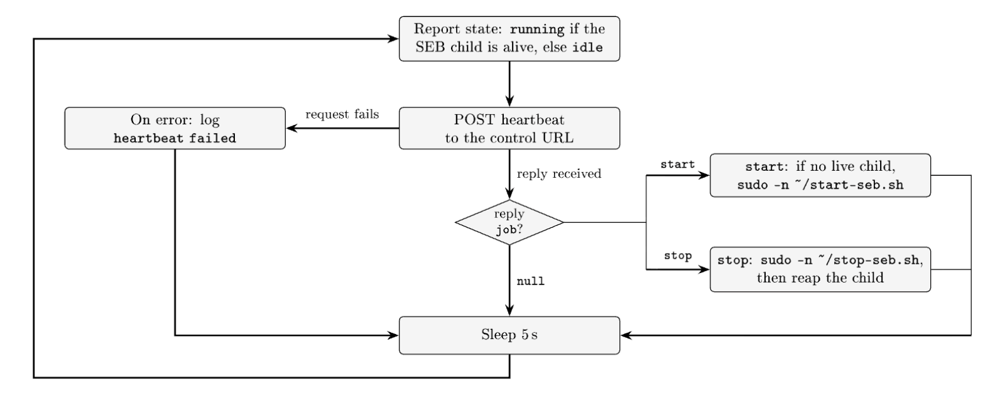

# riscv-exam-computer

A plug-and-play secure exam computer on a RISC-V SBC. It boots a locked-down Linux environment and a Safe Exam Browser kiosk for Canvas exams.

This repo is the exam/kiosk glue. Board OS images are built in [cannon-spencer/reptilian-riscv](https://github.com/cannon-spencer/reptilian-riscv).

## Usage

SD card in this machine (`diskutil list`; never `disk0`):

```bash
./scripts/flash-os.sh --device /dev/rdiskN
```

Starts Docker and the Cloudflare tunnel:

```bash
./scripts/deploy-server.sh
```

Board (agent POSTs to that same host; the token comes from `.env`):

```bash
./scripts/install-software.sh --host orangepi@10.0.0.xx
./scripts/install-seb.sh --host orangepi@10.0.0.xx
```

`install-software.sh` names a fresh board (hostname still `orangepi`) `orangepi-<hardware id>`, the same name every time for the same board, so boards show up separately in the console. A board with another name keeps it; `--rename` switches it to its hardware name.

## How the OS is built

`reptilian-riscv` holds the Orange Pi kernel, U-Boot, and image builder. That repo rarely changes.

On push to `main`, its CI runs `scripts/ci-build.sh` on Ubuntu 22.04 and publishes both files on the `orangepi-rv` GitHub Release:

- `visionfive2_fw_payload.img`
- `os.img.xz`

This repo’s flash script downloads:

```
https://github.com/cannon-spencer/reptilian-riscv/releases/download/orangepi-rv/os.img.xz
```

## Layout

- `platform/reptilian-riscv/` — board sources (submodule)
- `platform/seb-linux/` — Safe Exam Browser (submodule)
- `exam-env/` — board agent, server API, admin UI
- `scripts/flash-os.sh` — write the SD image
- `scripts/install-software.sh` — cross-compile `seb-agent`, scp it, enable the user systemd unit
- `scripts/build-seb.sh` — build `platform/seb-linux` on a board over SSH, copy the binary and WebKitGTK extension into `cache/` (`--upload` puts them on the release)
- `scripts/install-seb.sh` — install `safe-exam-browser` and its WebKitGTK extension (from `cache/`, else the release)
- `scripts/deploy-server.sh` — Docker-build `exam-env/server`, run it, and open the Cloudflare tunnel from `.env`
- `docs/` — course LaTeX

## Clone

```bash
git clone --recurse-submodules https://github.com/cannon-spencer/riscv-exam-computer.git
```

## Architecture

Boards poll the server; the server never connects to a board.



Agent loop (`exam-env/seb-agent`):



Beta build and known bugs: [docs/latex/m4-beta-build.tex](docs/latex/m4-beta-build.tex).
Test plan: [docs/latex/t2-beta-test-plan.tex](docs/latex/t2-beta-test-plan.tex).
